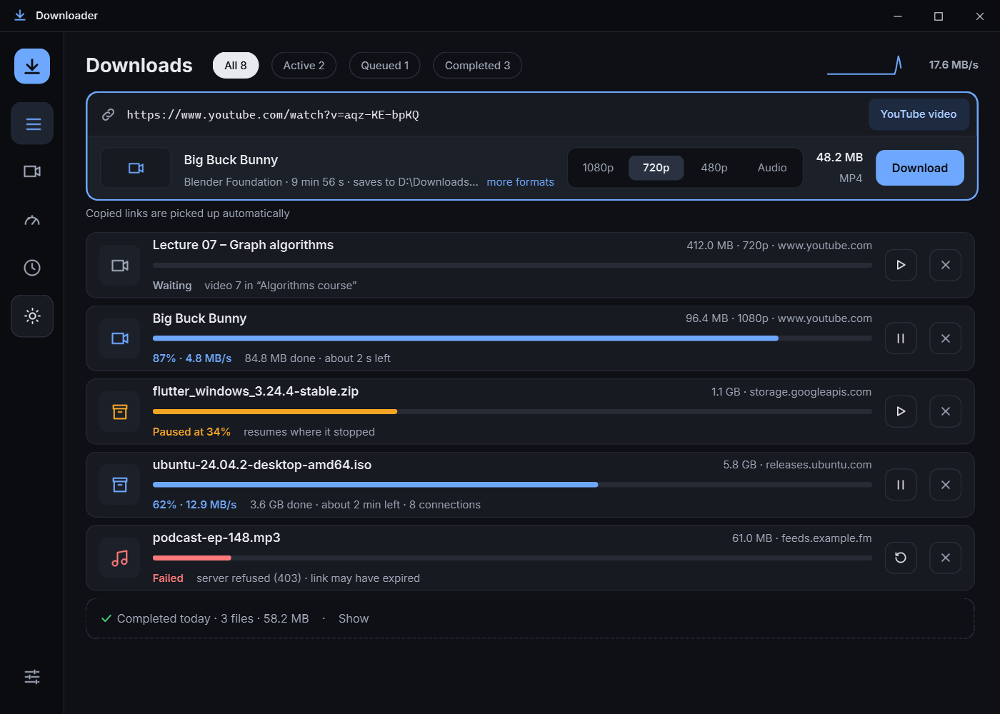
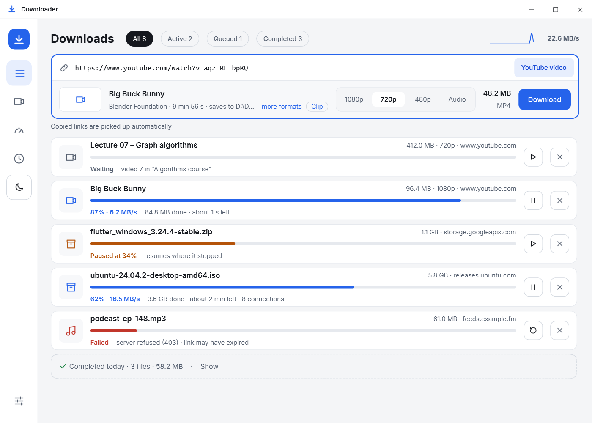
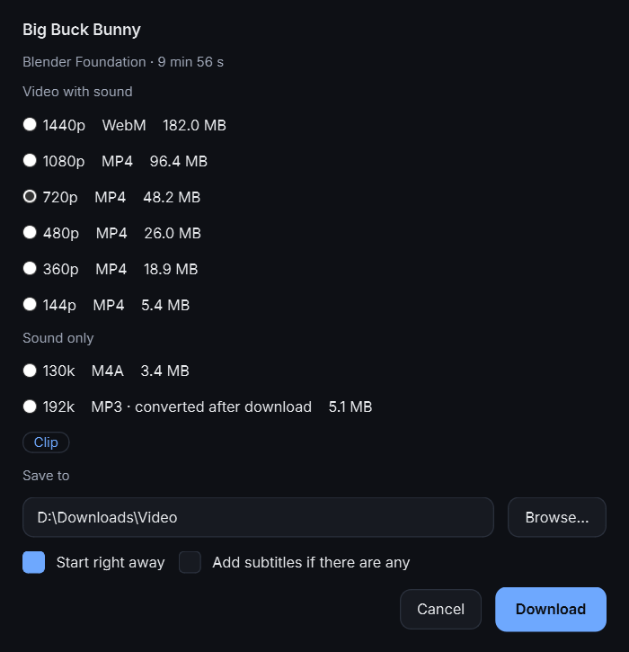
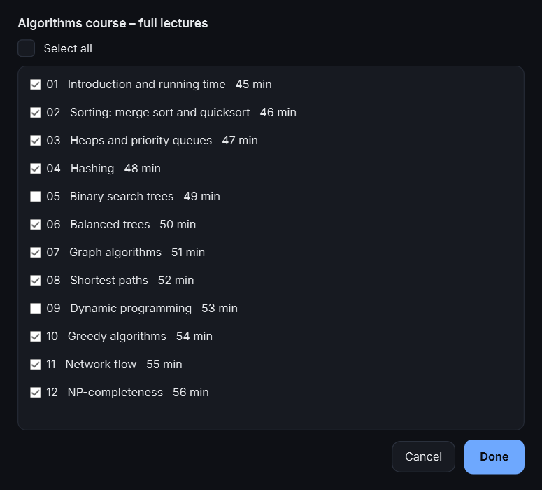
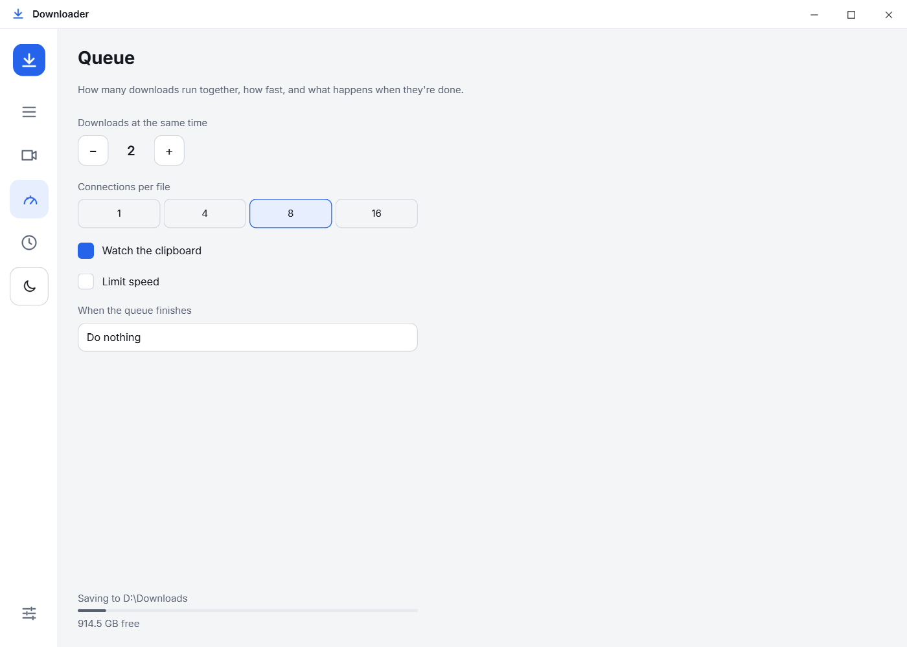

<div align="center">


# Downloader

**A fast, good-looking download manager for Windows.**<br>
Paste any link (a file, a YouTube video or a whole playlist) and Downloader works out what it is.

[](#install)
[](#run-from-source)
[-41CD52?logo=qt&logoColor=white)](https://doc.qt.io/qtforpython-6/)
[](LICENSE)

[**Download for Windows**](../../releases/latest) · [Features](#features) · [Run from source](#run-from-source)

<br>



</div>

<br>

## Light or dark, your choice

The whole window follows the theme, title bar included. Switch with the sun/moon button on the left.

<table>
  <tr>
    <td></td>
    <td></td>
  </tr>
  <tr>
    <td align="center"><sub>Dark</sub></td>
    <td align="center"><sub>Light</sub></td>
  </tr>
</table>

## Features

<table>
  <tr>
    <td width="50%" valign="top">

### One smart paste bar
Paste anything. A **file** starts right away. A **YouTube video** shows quality buttons
(1080p · 720p · 480p · Audio) with the size of each. A **playlist** shows how many videos,
how long, and how big. Links you copy anywhere appear here by themselves.

### Fast, and it picks up where it stopped
Each file is split into parts fetched over **1, 4, 8 or 16 connections** at once. Pause, close
the app, come back tomorrow: it resumes from the bytes it already has. Servers that refuse many
connections are handled by backing off to one at a time.

### Never loses or overwrites your files
A name that's taken gets ` (2)`. Network drops are retried by themselves. Errors are written for
people: *"server refused (403) · link may have expired"*, with a **Retry** button.

### Knows what you already have
Paste a link you downloaded last week and it says so, with **Open folder** right there, even
when it's the same YouTube video under a different link. A file that turns out identical to one
already in the folder is pointed out, with **Delete this copy** or **Keep both**.

### Checks the file arrived intact
Paste a checksum (SHA-256, SHA-1 or MD5), or let the app find the `SHA256SUMS` a site publishes
next to the file. Once downloaded, the card says **✓ SHA-256 verified**, or warns that the file
may be damaged and keeps it aside.

  </td>
  <td width="50%" valign="top">
    
  </td>
  </tr>
  <tr>
    <td width="50%" valign="top">
    
  </td>
    <td width="50%" valign="top">

### YouTube videos and whole playlists
Pick the quality once for a whole playlist, or tick just the videos you want. Files are
numbered (`01 - Title.mp4`) into a folder named after the playlist. Videos are saved as **H.264
MP4 with sound**, so they play in any player. "More formats" offers every quality, sound-only
M4A, and MP3.

### Subtitles, too
Turn them on in Settings and they're saved next to each video.

### Just the part you want
Switch on **Clip** and download only minutes 12:30–15:00 of a long video. A link shared with a
start time (`&t=750`) fills in **From** by itself. Cuts are exact, and the file is named
`Title (12-30 to 15-00).mp4`.

  </td>
  </tr>
  <tr>
    <td width="50%" valign="top">

### A queue that runs itself
Choose how many downloads run at once; the rest wait their turn, and **Start now** jumps the
line. Set a **speed limit** to keep the connection usable, and decide what happens when
everything's done: nothing, a notification, or **put the PC to sleep**.

### Scheduler
Start the queue at night and stop it in the morning, on the days you choose.

### Lives in the tray
Close the window and downloads carry on. You get a note when something finishes or fails.

  </td>
  <td width="50%" valign="top">
    
  </td>
  </tr>
</table>

## Install

1. Download `downloader-<version>-windows.zip` from the [latest release](../../releases/latest).
2. Unzip it anywhere and run **`downloader.exe`**.

No installer and no Python needed; FFmpeg is included. Your downloads list and settings are kept
in `%LOCALAPPDATA%\Downloader`.

## Run from source

Python 3.10 or newer on Windows:

```bash
python -m venv .venv
.venv\Scripts\activate
pip install -e .
python -m downloader
```

Set `DOWNLOADER_HOME` to keep the downloads list and settings somewhere other than
`%LOCALAPPDATA%\Downloader`.

### Tests

```bash
pip install -e .[dev]
python -m pytest                 # add RUN_NETWORK=1 to include the tests that talk to YouTube
```

The download engine is tested against a local test server that can refuse partial downloads,
hide the file size, drop connections, redirect, and limit connections.

### Build the .exe

```powershell
powershell -File scripts\build_exe.ps1   # set DOWNLOADER_BUILD to choose the output folder
```

## How it's built

| Part | What it does |
|---|---|
| `downloader/engine` | Plain Python, no Qt: link detection, multi-connection HTTP downloads with resume, the queue, the scheduler, YouTube through yt-dlp, and a SQLite store. |
| `downloader/ui` | PySide6 window. A controller turns the engine's background-thread events into Qt signals, so the window never waits on the network. |
| `scripts/` | Building the `.exe` (PyInstaller) and drawing the app icon. |

## Please note

Downloader is for downloading content you have the right to download. Respect the terms of the
sites you use and the rights of the people who made the content.

## Credits

- [yt-dlp](https://github.com/yt-dlp/yt-dlp) (Unlicense) for YouTube.
- [FFmpeg](https://ffmpeg.org), via [imageio-ffmpeg](https://github.com/imageio/imageio-ffmpeg), for joining video and sound.
- [Qt for Python (PySide6)](https://doc.qt.io/qtforpython-6/) (LGPLv3) for the interface.
- [Inter](https://rsms.me/inter/) by Rasmus Andersson (SIL Open Font License 1.1, see `downloader/ui/assets/fonts/OFL.txt`).

<div align="center">
<sub>MIT License · A rewrite of a little PyQt5 downloader I made back in 2018.</sub>
</div>
